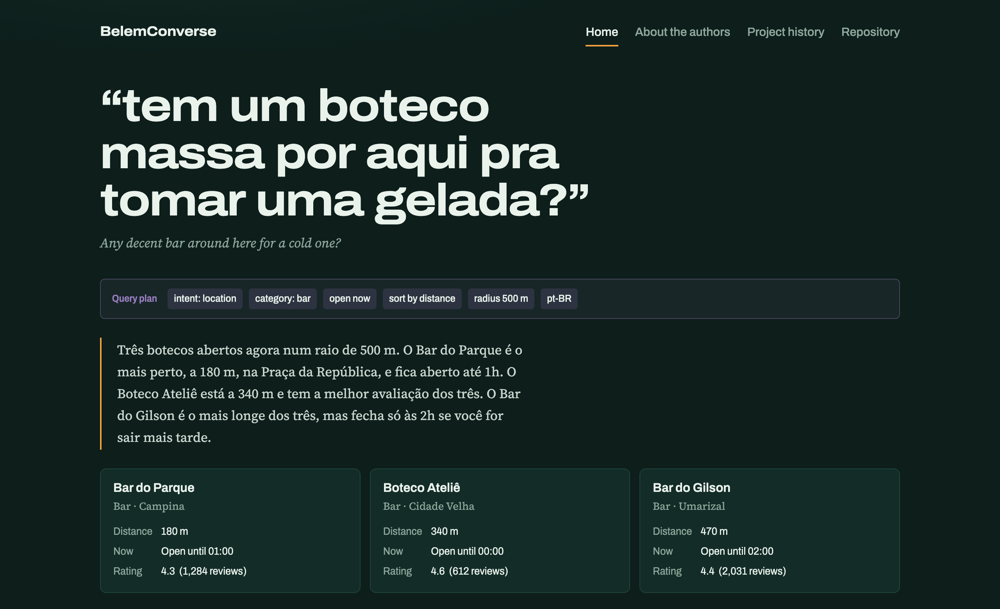
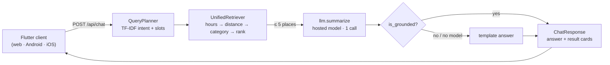

<div align="center">


# BelemConverse

**Grounded, bilingual place discovery for Belém do Pará.**<br>
Ask where to go in Portuguese or English — get answers built only from places that actually exist.

<!-- Project -->
[](specs/mvp/spec.md)
[](LICENSE)
[](pyproject.toml)
[](https://mollinetti.github.io/BelemConverse/)
[](https://cop30.br/pt-br)
[](https://github.com/Mollinetti/BelemConverse/commits/main)
[](https://github.com/Mollinetti/BelemConverse/stargazers)

<!-- Stack -->
[](https://fastapi.tiangolo.com/)
[](https://docs.pydantic.dev/)
[](https://flutter.dev/)
[](https://dart.dev/)
[](https://scikit-learn.org/)
[](https://www.openstreetmap.org/)
[](Dockerfile)
[](tests/)
[](https://github.com/astral-sh/ruff)

[**Try it**](https://mollinetti.github.io/BelemConverse/app/) ·
[**Project site**](https://mollinetti.github.io/BelemConverse/) ·
[**Specs**](docs/archive/spec/) ·
[**Authors**](https://mollinetti.github.io/BelemConverse/authors.html)

<br>

<a href="https://mollinetti.github.io/BelemConverse/">
  
</a>

<sub>From the <a href="https://mollinetti.github.io/BelemConverse/">project site</a>. Queries are real; figures are illustrative.</sub>

</div>

---

## Table of contents

- [Why](#why)
- [What it does](#what-it-does)
- [How it works](#how-it-works)
- [Example queries](#example-queries)
- [Getting started](#getting-started)
- [Running with Docker](#running-with-docker)
- [Deploy (free tier)](#deploy-free-tier)
- [Cost](#cost)
- [Use it for another town](#use-it-for-another-town)
- [Configuration](#configuration)
- [API](#api)
- [Project structure](#project-structure)
- [Testing](#testing)
- [Specifications](#specifications)
- [Contributing](#contributing)
- [Authors](#authors)
- [Acknowledgements](#acknowledgements)
- [License](#license)

## Why

In November 2025 Belém hosted [COP30](https://cop30.br/pt-br), the UN climate
conference, and tens of thousands of visitors arrived in a city most of them
had never seen. General-purpose search serves São Paulo and Rio far better than
it serves Belém — and general-purpose chatbots will happily recommend a
restaurant that closed years ago, or never existed.

BelemConverse answers the ordinary questions a visitor or resident actually
asks — *what's open, what's close, what's good* — from a curated index of local
places, in the language they asked in. The language model never searches; it
only describes what deterministic retrieval hands it.

## What it does

- **Understands how people really ask.** A TF-IDF intent classifier handles
  formal and colloquial phrasing in both languages — *"Closest restaurants open
  now"* and *"cadê uma barbearia bacana aqui pertinho?"* alike.
- **Filters before it ranks.** Opening hours, then proximity with a radius that
  escalates 500 m → 1 km → 2 km, then category. Rating and popularity only
  reorder what survives.
- **Searches near you only in Belém.** A shared location outside the city's
  bounds (from the city profile) is ignored: no distances from another city,
  and a "near me" question is told why before getting places from across
  Belém.
- **Cannot invent a place.** At most five retrieved places reach the model, and
  its reply is checked: if it names anything else, the visitor gets a plain
  template answer instead.
- **Says so when nothing matches.** Zero results after full escalation produces
  a clarifying question, not a plausible substitute.
- **Runs on free hardware.** No model weights, GPU or vector store: a small
  hosted model writes the reply, and without one (or when it fails) the API
  still answers with a template.

## How it works



| Stage | Component | Responsibility |
| --- | --- | --- |
| **Plan** | `QueryPlanner` | Turns the message into a structured plan: intent, category, open-now, sort mode, language. Falls back to keyword matching if the classifier is unavailable. |
| **Retrieve** | `UnifiedRetriever` | Applies filters in fixed precedence, escalates the radius until five results exist, then ranks. No vector search. |
| **Answer** | `llm.summarize` + `is_grounded` | One call to a hosted, OpenAI-compatible model writes the reply in EN or pt-BR from the top five places. A reply that names a place outside them is replaced by the template answer. |

The full retrieval and ranking rules live in
[`docs/archive/spec/03-query-planner.md`](docs/archive/spec/03-query-planner.md) and
[`docs/archive/spec/04-ranking-spec.md`](docs/archive/spec/04-ranking-spec.md); the model's
constraints in [`docs/archive/spec/06-llm-contract.md`](docs/archive/spec/06-llm-contract.md).

## Example queries

| Query | Language | Extracted plan |
| --- | --- | --- |
| *Closest restaurants open now* | EN | restaurant · open now · sort by distance |
| *Best rated sushi near me open now* | EN | sushi · open now · sort by rating |
| *Is Mercado Ver-o-Peso still open?* | EN | verification · named place · business hours |
| *tem um boteco massa por aqui pra tomar uma gelada?* | pt-BR | bar · open now · sort by distance |
| *Onde posso encontrar açaí por aqui?* | pt-BR | açaí · sort by distance |

Worked examples with full answers are on the
[project site](https://mollinetti.github.io/BelemConverse/);
the evaluation set is [`docs/archive/spec/09-eval-golden-queries.md`](docs/archive/spec/09-eval-golden-queries.md).

## Getting started

### Prerequisites

- Python **3.10+**
- [Flutter](https://docs.flutter.dev/get-started/install) with Dart SDK **^3.10**, only if you want the client
- The raw Google Places export (`data/csvs/combined_all_data.csv`) — columns are documented in [`docs/archive/spec/02-csv-mapping.md`](docs/archive/spec/02-csv-mapping.md)
- Optionally, an API key for a free hosted model (see [Configuration](#configuration))

### 1. Install the backend

```bash
git clone https://github.com/Mollinetti/BelemConverse.git
cd BelemConverse

python -m venv .venv
source .venv/bin/activate            # Windows: .venv\Scripts\activate
pip install -e ".[dev,tools]"        # tools = pandas, for the catalog build
```

### 2. Build the place catalog

The Belém catalog is committed as [`catalog/belem.sqlite`](catalog/), so this
step is only needed to rebuild it from the raw export:

```bash
python -m belem_converse.tools.build_catalog      # → catalog/belem.sqlite + cleaning_report.json
python -m belem_converse.tools.validate_osm       # optional: flag places OpenStreetMap confirms
```

The build deduplicates, repairs broken accents, parses opening hours and keeps
only places in the Belém municipality; `cleaning_report.json` counts every fix.

### 3. Configure a model (optional)

```bash
cp .env.example .env    # then set LLM_BASE_URL, LLM_MODEL, LLM_API_KEY
```

Without a model every answer is the template answer.

### 4. Start the API

```bash
uvicorn api.main:app --reload --port 8000
curl -s http://localhost:8000/api/health | jq
```

Interactive docs: <http://localhost:8000/docs> · ReDoc: <http://localhost:8000/redoc>

### 5. Ask something

```bash
curl -s http://localhost:8000/api/chat \
  -H "Content-Type: application/json" \
  -d '{
        "session_id": "'"$(uuidgen)"'",
        "message": "Closest restaurants open now",
        "language": "en",
        "userLocation": { "lat": -1.4500, "lng": -48.4900 }
      }' | jq
```

A conversation is up to 4 questions on one `session_id`; send
`"action": "more"` (no message) for the next 5 results of the last answer.
Messages may contain letters, digits, spaces and `, . : ? !` only, up to 400
characters.

### 6. Run the client (optional)

```bash
cd frontend
flutter pub get
flutter run -d chrome
```

The client expects the API at `http://localhost:8000/api`. To point it
elsewhere, pass `--dart-define=API_BASE_URL=http://<host>:8000/api`.

## Running with Docker

```bash
docker compose up --build              # API on http://localhost:8000
```

The image holds the API and the committed catalog only; model settings come
from `.env`. To run it on its own:

```bash
docker build -t belemconverse .
docker run --rm -p 8000:8000 --env-file .env belemconverse
```

## Deploy (free tier)

The public showcase is a static Flutter web build on GitHub Pages talking to
one free Docker web service on [Render](https://render.com). Nothing else is
hosted: the catalog is in the image and the model is a hosted free tier.

**Backend (Render).** In the Render dashboard choose *New → Blueprint* and
point it at this repository; [`render.yaml`](render.yaml) creates the
`belemconverse` web service (Docker, free plan, health check `/api/health`).
Enter the two secrets it marks `sync: false`, `LLM_API_KEY` and
`LLM_FALLBACK_API_KEY`, in the service's *Environment* tab. Then:

```bash
curl -s https://<service>.onrender.com/api/health     # {"status": "healthy", ...}
```

A free service sleeps after 15 idle minutes and takes about a minute to wake;
the client shows a waking-up banner meanwhile.

**Frontend (GitHub Pages).** Build the client against the backend and copy it
under `docs/app/`, which Pages serves from `main:/docs`:

```bash
cd frontend
flutter build web --release --base-href /BelemConverse/app/ \
  --dart-define=API_BASE_URL=https://<service>.onrender.com/api
cd .. && rm -rf docs/app && rsync -a --exclude canvaskit frontend/build/web/ docs/app/
```

`canvaskit/` is left out: the app loads its renderer from Google's CDN, so the
26 MB folder would only bloat the repository.

Commit `docs/app/` and push to `main`. In the repository settings, *Pages*
must serve the `main` branch from `/docs`. The backend only accepts browser
calls from `ALLOWED_ORIGINS` (`https://mollinetti.github.io` in `render.yaml`),
so set it to your own Pages origin if you fork.

## Cost

$0 a month. Render's free web service, GitHub Pages and the model providers'
free tiers ([Google AI Studio](https://aistudio.google.com) primary,
[Groq](https://console.groq.com) fallback) cover it. Two limits keep it there:

- **Per visitor:** 20 messages in 10 minutes (then `429`), and 4 questions per
  conversation; "see more" never calls the model.
- **Per day:** `LLM_DAILY_CAP` model calls (default 800). Past the cap every
  answer is the template answer, so the app keeps working.

## Use it for another town

1. **City profile.** Copy [`belem_converse/cities/belem.py`](belem_converse/cities/belem.py)
   to `<town>.py` and change the name, bounds, time zone, municipalities,
   `catalog_path` (`catalog/<town>.sqlite`) and the follow-up `category_labels`.
   Register it in `_load_builtin_cities()` in
   [`city_loader.py`](belem_converse/cities/city_loader.py).
2. **Catalog.** Export places for the town (Google Places columns, see
   [`02-csv-mapping`](docs/archive/spec/02-csv-mapping.md)) and build it:

   ```bash
   BELEMCONVERSE_CITY=<town> python -m belem_converse.tools.build_catalog --csv path/to/export.csv
   ```

   This writes `catalog/<town>.sqlite` and `catalog/cleaning_report.json`;
   commit both.
3. **Deploy.** Set `BELEMCONVERSE_CITY=<town>` on the Render service, then
   follow [Deploy](#deploy-free-tier). Update the link-preview tags (title,
   description, `og:url`, `og:image`) in
   [`frontend/web/index.html`](frontend/web/index.html) and the names in
   `frontend/web/manifest.json`. The model prompt names Belém in
   [`llm.py`](belem_converse/llm.py); change it too.

## Configuration

Copy [`.env.example`](.env.example) to `.env` and uncomment what you need.
The model client is [`belem_converse/llm.py`](belem_converse/llm.py); paths live in
[`belem_converse/utils/config.py`](belem_converse/utils/config.py).

| Variable | Default | Purpose |
| --- | --- | --- |
| `LLM_BASE_URL` | unset | OpenAI-compatible endpoint; unset means template answers only |
| `LLM_MODEL` | unset | Model name at that endpoint |
| `LLM_API_KEY` | unset | Bearer token for the endpoint |
| `LLM_FALLBACK_BASE_URL`, `LLM_FALLBACK_MODEL`, `LLM_FALLBACK_API_KEY` | unset | Second provider, tried when the first is rate-limited, fails or times out |
| `LLM_TIMEOUT_S` | `10` | Seconds shared by both providers before the template answer is used; each gets an equal share of what is left, so a slow primary cannot starve the fallback |
| `LLM_MAX_TOKENS` | `250` | Cap on the reply's length |
| `LLM_DAILY_CAP` | `800` | Model calls per Belém calendar day; past it, answers are templates |
| `ALLOWED_ORIGINS` | unset | Browser origins allowed by CORS, comma-separated; unset allows only `http://localhost` / `127.0.0.1` |
| `BELEM_DATA_DIR` | `data/` | Raw exports read by the catalog build (the API reads `catalog/`) |
| `BELEMCONVERSE_CITY` | `belem` | City profile (see [Use it for another town](#use-it-for-another-town)) |

## API

All routes are mounted under `/api`. The contract is
[`api/schemas.py`](api/schemas.py), served live at `/openapi.json`. The archived
[`docs/archive/spec/05-openapi.yaml`](docs/archive/spec/05-openapi.yaml) predates
mvp-2 and still lists routes and fields that were removed.

| Method | Path | Purpose |
| --- | --- | --- |
| `GET` | `/api/health` | Liveness; ready once the place catalog is loaded |
| `POST` | `/api/chat` | Plan → retrieve → summarise; returns an answer, up to 5 results, follow-up suggestions, `has_more` and `turns_left` |

`/api/chat` answers `422` for a message outside the input rule (localized),
`409` when the conversation's 4 questions are used (`conversation_finished`)
or there is nothing to see more of (`no_previous_results`), and `429` after 20
messages from one visitor in 10 minutes (`rate_limited`).

## Project structure

```
.
├── api/                  FastAPI app — main, routes, schemas, dependencies
├── belem_converse/       Backend package (pip install -e .)
│   ├── cities/           City profiles (Belém by default)
│   ├── classifiers/      TF-IDF intent classifier + trained artefacts
│   ├── core/             Query planner, retriever, ranking
│   ├── ingest/           CSV field mapping, OSM fetcher and matcher
│   ├── tools/            build_catalog, validate_osm, bench_llm
│   ├── utils/            Base paths, hours parser
│   ├── catalog.py        Reads the SQLite place catalog
│   └── llm.py            Hosted-model client and grounding check
├── catalog/              The committed Belém place catalog + build reports
├── frontend/             Flutter client
├── scripts/              Repo maintenance scripts (reachability check)
├── specs/mvp/            Current specs (mvp-1, mvp-2, mvp-3)
├── docs/
│   ├── archive/spec/     Proof-of-concept specs + ADRs (reference)
│   └── index.html …      Project site (GitHub Pages)
├── notebooks/            Exploratory notebooks: local only, not in git
├── tests/                pytest suite + diagnostics/ eval harnesses
└── data/                 Raw exports for the catalog build — gitignored
```

## Testing

```bash
pip install -e ".[dev,tools]"
pytest                                               # full suite
pytest tests/test_query_planner_refactoring.py -v    # one file
ruff check .                                         # lint
```

[`tests/conftest.py`](tests/conftest.py) puts the project root on the path, so
the suite runs even before `pip install -e .`.

## Specifications

Behaviour is specified before it is built. The current spec is the two-phase
free-tier MVP in [`specs/mvp/`](specs/mvp/spec.md). The proof-of-concept specs
below are archived under [`docs/archive/spec/`](docs/archive/spec/) and kept for
reference; where they disagree with `specs/mvp/`, the MVP spec wins.

| Spec | Covers |
| --- | --- |
| [`00-poc-charter`](docs/archive/spec/00-poc-charter.md) | Scope, success criteria, non-goals |
| [`01-domain-model`](docs/archive/spec/01-domain-model.md) · [`02-csv-mapping`](docs/archive/spec/02-csv-mapping.md) | The canonical `Place` entity and how CSVs map onto it |
| [`03-query-planner`](docs/archive/spec/03-query-planner.md) · [`04-ranking-spec`](docs/archive/spec/04-ranking-spec.md) | Retrieval precedence and ranking rules |
| [`05-openapi.yaml`](docs/archive/spec/05-openapi.yaml) | The original API contract (superseded by `/openapi.json`) |
| [`06-llm-contract`](docs/archive/spec/06-llm-contract.md) | Summarise-only, no-hallucination rules for the model |
| [`07-ux-flutter`](docs/archive/spec/07-ux-flutter.md) · [`08-i18n`](docs/archive/spec/08-i18n.md) | Client behaviour and localisation |
| [`09-eval-golden-queries`](docs/archive/spec/09-eval-golden-queries.md) · [`10-runbook`](docs/archive/spec/10-runbook.md) · [`11-demo-script`](docs/archive/spec/11-demo-script.md) | Evaluation, operations, demo |
| [`12-intent-classifier-improvement-plan`](docs/archive/spec/12-intent-classifier-improvement-plan.md) | TF-IDF classifier roadmap |

Architecture decisions are recorded in [`docs/archive/spec/decisions/`](docs/archive/spec/decisions/).

## Contributing

Issues and pull requests are welcome. Before opening a PR:

1. Check the relevant phase in [`specs/mvp/`](specs/mvp/spec.md) — behaviour changes should update it.
2. Run `ruff check .` and `pytest`.
3. Keep the LLM contract intact: the model summarises retrieved places and nothing else.

## Authors

<table>
  <tr>
    <td align="center" width="200">
      <a href="https://github.com/Mollinetti">
        <br>
        <b>Marco Mollinetti</b>
      </a><br>
      <sub>Project lead</sub><br>
      <a href="https://www.linkedin.com/in/marco-antonio-florenzano-mollinetti/">LinkedIn</a>
    </td>
    <td align="center" width="200">
      <a href="https://github.com/ArturNakauchi">
        <br>
        <b>Artur Nakauth Freires</b>
      </a><br>
      <sub>Collaborator</sub><br>
      <a href="https://www.linkedin.com/in/arturfreires/">LinkedIn</a>
    </td>
  </tr>
</table>

More on both on the [project site](https://mollinetti.github.io/BelemConverse/authors.html).

## Acknowledgements

- [COP30](https://cop30.br/pt-br), for putting Belém in front of the world and giving this project its reason to exist
- [OpenStreetMap](https://www.openstreetmap.org/copyright) contributors, whose map data the client renders

## License

Released under the [MIT License](LICENSE).
